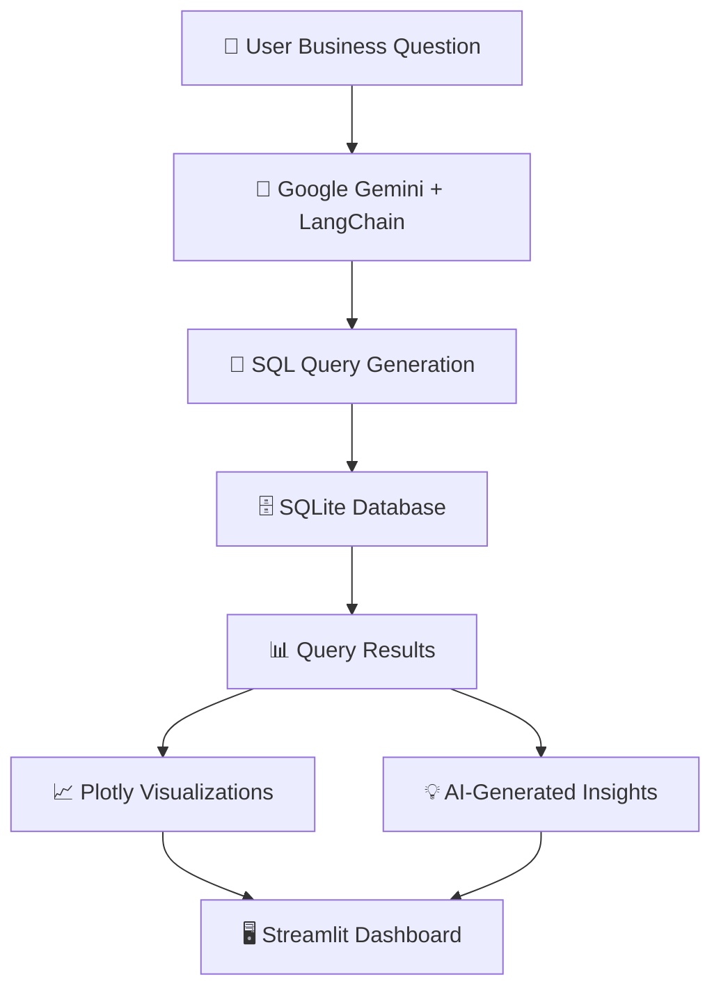

# 🤖 Enterprise AI Data Analyst Assistant

### Turn Natural Language into SQL Queries, Interactive Visualizations & Business Insights

An AI-powered analytics application that transforms plain-English business questions into executable SQL queries, interactive visualizations, and actionable business insights — all through a modern Streamlit interface.

Built with **Python, LangChain, Google Gemini, SQLite, and Plotly**, this project makes database analytics more accessible by allowing users to explore data without manually writing SQL queries.

<p align="center">

  

  

  

  

  

</p>

---

## ✨ Overview

Traditional database analysis often requires SQL knowledge, manual query writing, and separate visualization tools.

**Enterprise AI Data Analyst Assistant** simplifies this workflow by combining natural language processing, automated SQL generation, data analysis, and interactive charting in one application.

Ask a business question, execute the generated query, explore the results, and receive AI-generated insights — all within a single interface.

## 🚀 Key Features

<table>
  <tr>
    <td width="50%">

### 💬 Natural Language to SQL

Convert plain-English questions into SQL queries using Google Gemini and LangChain.

    </td>
    <td width="50%">

### 🧠 AI-Powered Insights

Generate contextual summaries that help explain query results and highlight potentially useful business patterns.

    </td>
  </tr>
  <tr>
    <td width="50%">

### 📊 Interactive Visualizations

Explore query results through dynamic charts powered by Plotly Express.

- Bar charts
- Line charts
- Scatter plots

    </td>
    <td width="50%">

### 🎨 Modern SaaS Interface

A custom-styled Streamlit experience featuring gradient aesthetics, metric cards, theme styling, and organized result views.

    </td>
  </tr>
  <tr>
    <td width="50%">

### 📁 Data Export

Download query results as CSV files for further analysis in spreadsheet applications.

    </td>
    <td width="50%">

### 🗄️ Database Integration

Connect to a SQLite database, inspect available schema information, and execute generated analytical queries against sample data.

    </td>
  </tr>
</table>

---

## 🛠️ Technology Stack

| Technology | Purpose |
|---|---|
| **Python** | Core application logic |
| **Streamlit** | Interactive web interface |
| **Google Gemini API** | Natural language understanding and insight generation |
| **LangChain** | LLM orchestration |
| **SQLite** | Relational database |
| **Pandas** | Data processing and tabular analysis |
| **NumPy** | Numerical operations |
| **Plotly Express** | Interactive data visualization |
| **Custom CSS** | UI styling and visual enhancements |

---

## 🏗️ Project Architecture

```text
nl-to-sql-assistant/
│
├── styles/
│   └── style.css          # Custom UI styling
│
├── app.py                 # Streamlit application and UI
├── database.py            # Database connection and query execution
├── llm_helper.py          # Gemini and LangChain integration
├── setup_db.py            # Database initialization and sample data
│
├── northwind.db           # SQLite sample database
├── requirements.txt       # Python dependencies
├── .env                   # API credentials (not committed)
└── README.md              # Project documentation
```

### 🔄 How It Works



1. **Ask:** The user enters a business question in plain English.
2. **Generate:** The AI generates an SQL query based on the available database schema.
3. **Execute:** The application executes the query against SQLite.
4. **Analyze:** The returned data is used to generate insights and interactive visualizations.
5. **Explore:** The user reviews the results and exports the data when needed.

---

## ⚙️ Installation & Setup

Follow these steps to run the project locally.

### 1. Clone the Repository

```bash
git clone https://github.com/YOUR_USERNAME/YOUR_REPOSITORY.git
cd nl-to-sql-assistant
```

Replace the repository URL and directory name with your actual GitHub repository details.

### 2. Create a Virtual Environment

**Windows**

```bash
python -m venv venv
venv\Scripts\activate
```

**macOS / Linux**

```bash
python3 -m venv venv
source venv/bin/activate
```

### 3. Install Dependencies

```bash
pip install -r requirements.txt
```

### 4. Configure Environment Variables

Create a `.env` file in the project's root directory:

```env
GOOGLE_API_KEY=your_google_gemini_api_key
```

Replace the placeholder with your Google Gemini API key.

Keep your API key private and never commit the `.env` file to GitHub.

### 5. Initialize the Database

If the sample database needs to be created or populated, run:

```bash
python setup_db.py
```

If `northwind.db` is already initialized and contains the required data, you may not need to run this step again.

### 6. Launch the Application

```bash
streamlit run app.py
```

Open the local URL displayed in your terminal, typically:

```text
http://localhost:8501
```

---

## 💡 Example Questions

Try asking questions such as:

| Category | Example Question |
|---|---|
| 📦 Sales | What are the top 10 products by sales? |
| 🌍 Geography | Which countries generate the most revenue? |
| 📈 Trends | How do sales change over time? |
| 🏆 Performance | Who are the top-performing customers? |
| 📊 Comparison | Compare sales across different product categories. |
| 🔍 Exploration | Show the total number of orders for each region. |

*These are example prompts; the actual results depend on the tables, columns, and data available in your database.*

---

## 🔐 Security & Best Practices

- Store API credentials in environment variables rather than source code.
- Add `.env`, virtual environments, and other sensitive or local-only files to `.gitignore`.
- Validate generated SQL before execution.
- Restrict database permissions and consider allowing only read-only analytical queries.
- Avoid exposing database credentials, sensitive records, or raw errors in the UI.
- Remember that AI-generated SQL and insights can be incorrect and should be reviewed before relying on them.

**Important:** AI-generated SQL should not automatically be treated as safe. Apply appropriate query validation and execution restrictions before using the application with production databases.

---

## 🎯 Project Goals

This project demonstrates the practical application of AI and data analytics technologies to simplify database interaction.

Key learning areas include:

- Integrating large language models into a Python application.
- Generating SQL from natural language.
- Connecting an AI layer to a relational database.
- Processing query results with Pandas.
- Building interactive data visualizations.
- Designing a modern analytics interface with Streamlit.
- Managing API credentials and application configuration.

---

## 🔮 Future Enhancements

Potential improvements for future versions include:

- [ ] Support for PostgreSQL and MySQL.
- [ ] SQL query validation and safer execution controls.
- [ ] Query history and saved business questions.
- [ ] Advanced dashboard filtering.
- [ ] Automated chart recommendations.
- [ ] Downloadable PDF reports.
- [ ] User authentication and role-based access.
- [ ] Conversation memory for follow-up questions.

---

## 👨‍💻 Author

**Mallesh Bhandari**

Aspiring Data Analyst and Python Developer passionate about building AI-powered applications, data-driven solutions, and interactive analytics tools.

- **GitHub:** [mallesh-bhandari](https://github.com/mallesh-bhandari)
- **LinkedIn:** [mallesh-bhandari](https://www.linkedin.com/in/mallesh-bhandari/)

---

<p align="center">

  **Built with Python, AI, and a passion for data.** 🚀

  <sub>Enterprise AI Data Analyst Assistant · Natural Language Analytics</sub>

</p>
